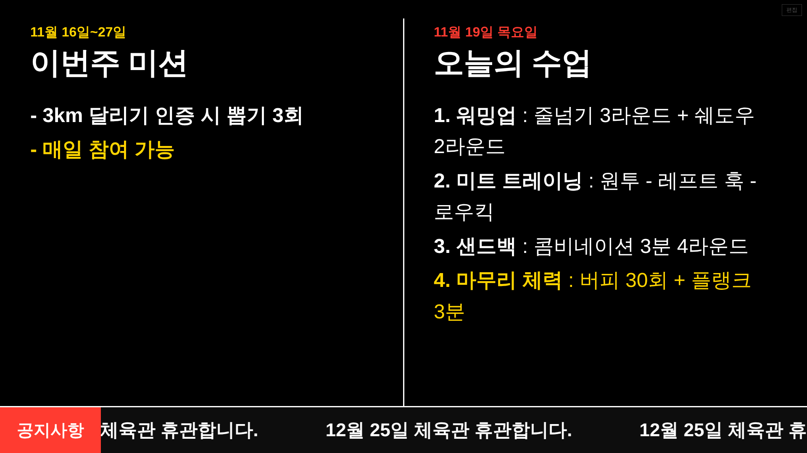

# tclub dashboard

| 파일 | 하는 일 |
|---|---|
| `index.html` | 전광판 화면 |
| `style.css` | 디자인 (검정 배경, 중앙선, 공지 띠) |
| `app.js` | 편집기, 로그인, 보관함 동작 |
| `config.js` | Firebase 연결 정보 (직접 채우는 곳) |
| `firestore.rules` | 관리자만 수정할 수 있게 막는 보안 규칙 |

## 화면

2026-11-19 버전 기준 화면입니다.

평소 화면

편집 화면

수업 보관함

## 비밀번호를 잊었을 때

로그인 창에서 관리자 이메일을 입력한 뒤 "비밀번호를 잊으셨나요?"를 누르면 그 주소로 재설정 메일이 발송됩니다. 메일의 링크에서 새 비밀번호를 정하면 됩니다. 외부인이 관리자 이메일을 알아낼 수 없도록, 등록되지 않은 주소를 넣어도 같은 안내가 나옵니다.

메일이 오지 않으면 스팸함을 확인하거나, Firebase 콘솔 Authentication > 사용자 탭에서 해당 계정의 메뉴로 직접 재설정할 수 있습니다.
