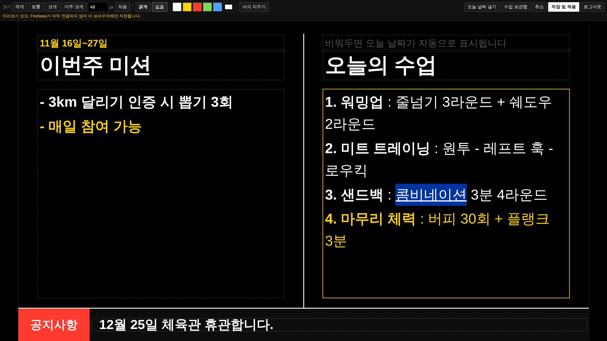
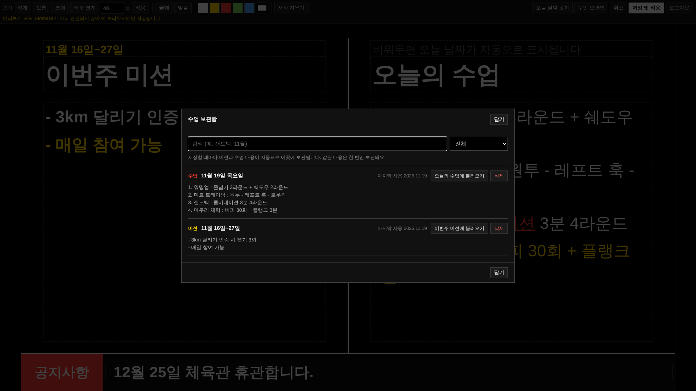

# tclub dashboard

| 파일 | 하는 일 |
|---|---|
| `index.html` | 전광판 화면 |
| `style.css` | 디자인 (검정 배경, 중앙선, 공지 띠) |
| `app.js` | 편집기, 로그인, 보관함 동작 |
| `config.js` | Firebase 연결 정보 (직접 채우는 곳) |
| `firestore.rules` | 관리자만 수정할 수 있게 막는 보안 규칙 |

## 화면

2026-11-19 버전 기준 화면입니다.

평소 화면

편집 화면

수업 보관함

